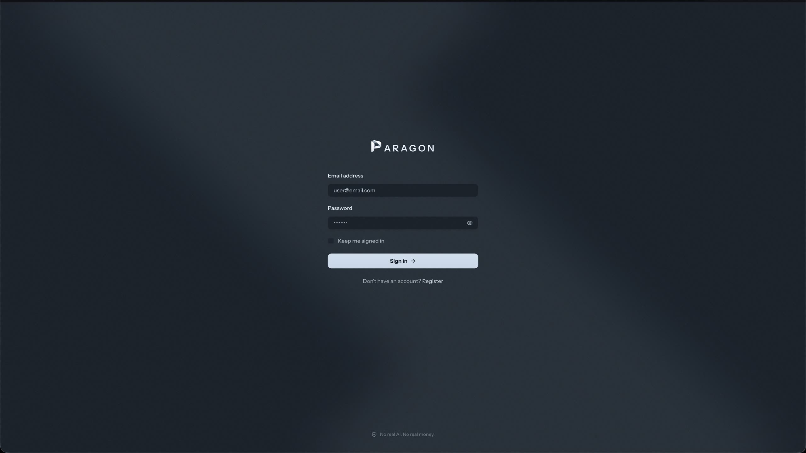
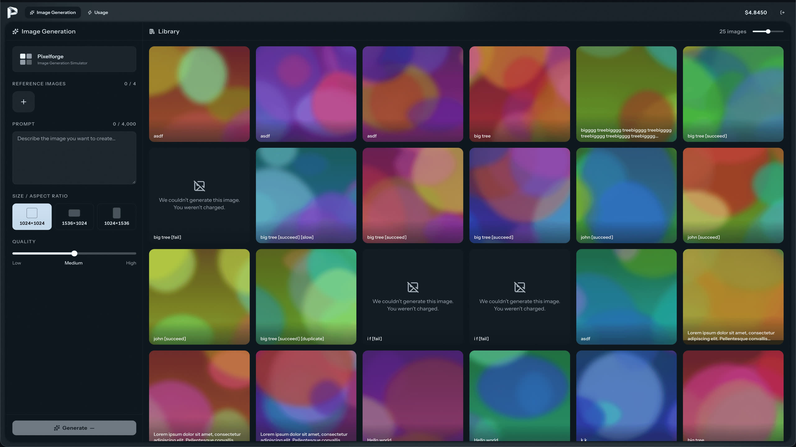
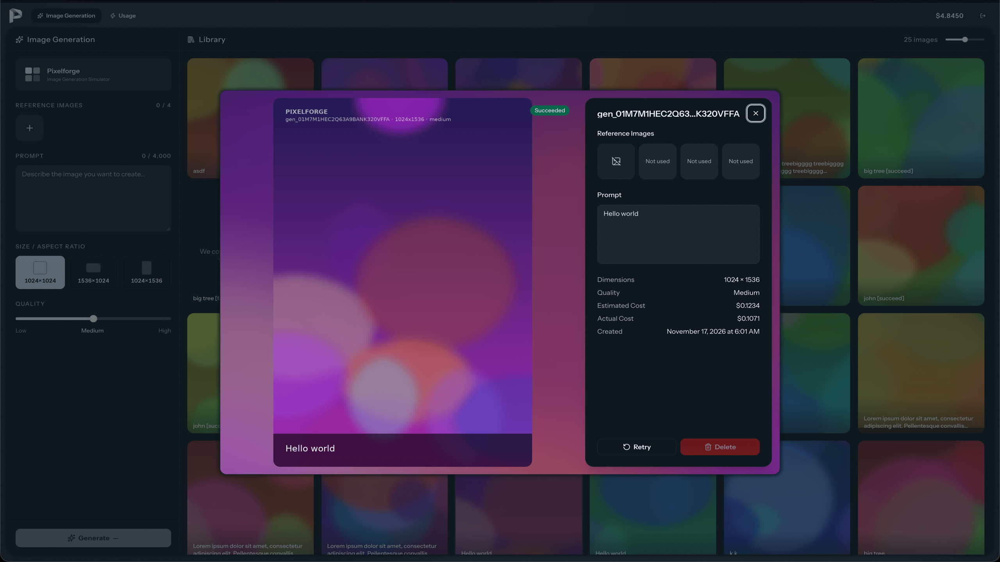
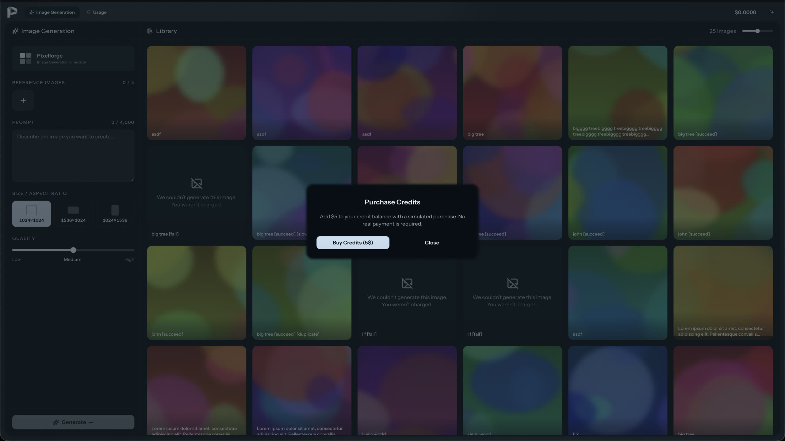
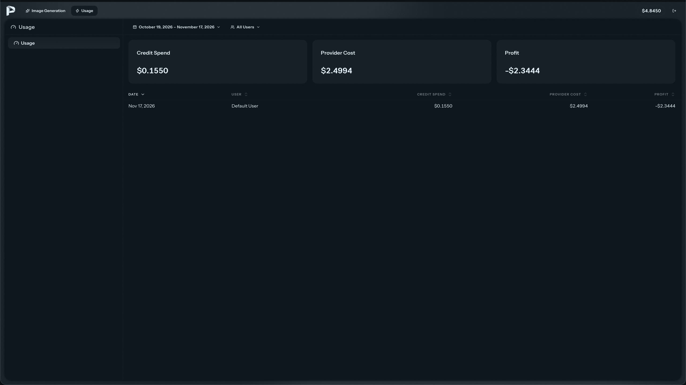

<br />
<div align="center">
    
</div>

<h1 align="center">Pixel — Pixelforge Assessment</h1>

<p align="center">
    Image generation with credit balances, usage reports, and reliable webhook processing.<br />
    <br />
    <a href="https://workspace-production-naec3k.laravel.cloud/">Try the live demo</a>
    <br /><br />
    <a href="https://laravel.com"></a>
    <a href="https://www.typescriptlang.org/"></a>
    <a href="https://vuejs.org/"></a>
    <a href="https://inertiajs.com/"></a>
    <a href="https://tailwindcss.com/"></a>
</p>

---

## Prerequisites

- **PHP** 8.5.12+ and **Composer**
- **Node.js** 26 and **npm** 11
- **PostgreSQL**
- A **Pixelforge API key and webhook secret**
- The repository’s `shared/` directory alongside `apps/`

---

## Installation

From `apps/pixelforge-project`, on a fresh checkout:

1. **Install dependencies and configure the application key**

   ```sh
   composer install
   npm --prefix ../../shared ci
   ln -s ../../shared/node_modules node_modules
   cp .env.example .env
   php artisan key:generate
   ```

2. **Configure `.env`**

   Set PostgreSQL credentials, an HTTPS `APP_URL`, `PIXELFORGE_API_KEY`, and `PIXELFORGE_WEBHOOK_SECRET`.

3. **Prepare the database and start development**

   ```sh
   php artisan migrate --seed
   php artisan storage:link
   composer run dev
   ```

---

## Demo Credentials

| Account | Email | Password |
| --- | --- | --- |
| User | user@email.com | password |

---

## Corners Cut

- **Polling instead of Reverb.** WebSockets would deliver immediate updates, but polling avoids extra infrastructure for an assessment.
- **PostgreSQL instead of SQLite.** SQLite supports `CHECK` constraints but does not enforce fixed-precision `DECIMAL` types like PostgreSQL. PostgreSQL provides exact monetary arithmetic and database-enforced billing constraints.
- **Shared report access.** Any signed-in user can view all users’ usage. Operator-only access was deliberately omitted to make assessment easier.
- **Demo login.** Seeded credentials are public, and the login form prefills the user account even in production. This deployment is intended for evaluation.
- **Simple billing.** As requested by the assessment, purchases are simulated: each click adds $5 without a payment provider. The pricing markup is fixed at 25% in configuration.
- **Manual reconciliation.** The report uses locally recorded provider costs, grouped by UTC completion day. Comparing them with Pixelforge’s `GET /v1/usage` is a manual check; there is no reconciliation dashboard or automatic discrepancy resolution.
- **The scheduler** runs `generations:sync` every minute to recover existing generations. Unknown provider records are skipped when no local generation matches their provider ID or submission UUID.

---

## Resolving an Uncertain Submission

If retries are exhausted and a generation remains `pending` with `submission_uncertain`, its credits stay reserved because Pixelforge may have accepted it. Run `php artisan generations:sync` first. If it remains unresolved, verify with Pixelforge that the request was never accepted, using the local generation UUID (also its idempotency key and `metadata.generation_uuid`). A timeout or missing webhook alone is not confirmation.

Only after confirming non-acceptance, run:

```sh
php artisan generations:resolve-submission <local-generation-uuid> --confirmed-not-accepted
```

The command rejects active submission attempts, records a zero-cost failure, releases the reservation, and logs the manual resolution. It does not add a refund transaction because the credits were reserved, not charged. Repeating the command is safe; delayed queue retries will no longer submit the failed generation.

---

## Notes

This repository is a selected snapshot of my personal monorepo. The application lives in `apps/pixelforge-project`, alongside shared libraries, UI components, and development tooling that it uses. These resources were reused from my existing workspace rather than built specifically for this assessment, so some files cover concerns beyond image generation.

The shared tooling supports code quality through formatting, linting, static analysis, and architectural rules. It helps catch mistakes, maintain a consistent code style, and keep responsibilities in the appropriate layers. Repository instructions and AI guidance document these conventions so coding assistants can follow the same patterns and constraints. Some included files are runtime dependencies; others support development and review.


## Tests

Create a separate PostgreSQL database named `pixelforge_testing`, then run `composer test` from `apps/pixelforge-project`. Tests rebuild that database and fake Pixelforge requests.

## Screenshots










